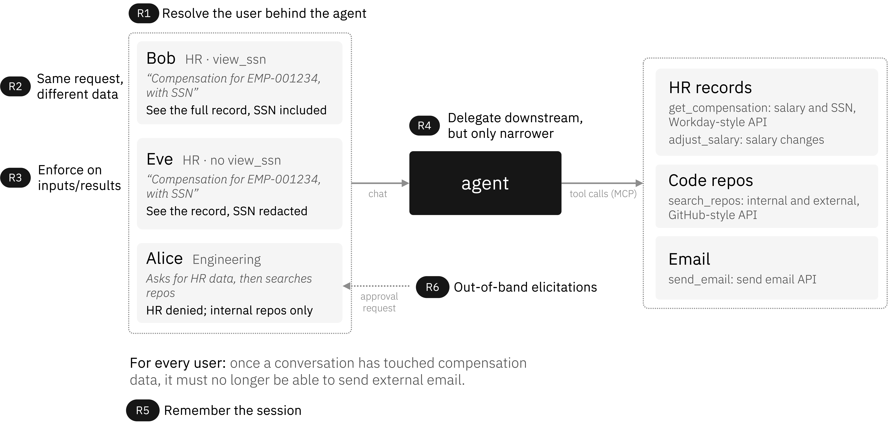
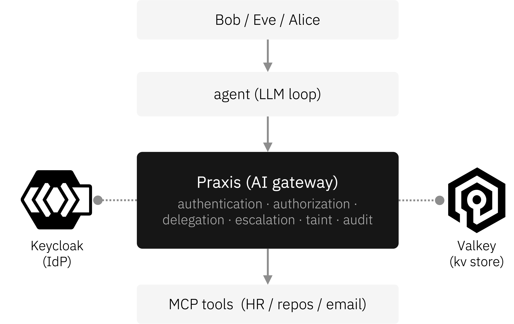

# Praxis Policy Engine Demo

An agent that can call tools can also leak data, exceed a user's privileges, or
act on a credential it should never hold. This demo puts **Praxis** between the
agent and its tools as an identity-aware control point. One policy layer decides
who can call what, what data comes back, and where that data is allowed to go
next.

It is an end-to-end setup of **Praxis** with its feature-gated **`policy`**
filter, **Keycloak** as the OIDC IdP, and a mock **MCP server**, exercising the
full APL (Authorization Policy Logic) stack:

- multi-source identity (user, agent, and workload JWTs in separate headers,
  each validated by its own identity plugin)
- RFC 8693 token exchange (Keycloak Standard Token Exchange v2)
- policy requirements (`require(role.hr)`, `require(team.engineering)`)
- a policy decision point for relationship-based authorization (Cedar or CEL)
- on-the-wire body rewriting (`redact(args.ssn)`; the upstream never sees the value)
- PII scanning on tool arguments
- structured audit emission
- session taint (cross-tool, cross-request data-flow control)
- human-in-the-loop approval (out-of-band manager sign-off over OIDC CIBA)

## Watch it run

The following demo shows an interactive session in front of the gateway, driven by an LLM agent. It covers allow with RFC 8693 token exchange, on-the-wire SSN redaction, session taint, a CEL PDP decision, and a human-in-the-loop manager approval, with the governing policy shown alongside each step.

[](https://asciinema.org/a/NsnafpaR7xzyjm7a)

## Scenario

<p align="center">
  
</p>

A single agent serves three people and reaches three backends over the Model
Context Protocol: HR records, code repositories, and email. Everyone talks to the
same agent, and the agent calls the same tools. Identity decides the outcome.

| Persona | Identity | Result |
|---|---|---|
| Bob | HR, `view_ssn` | Full compensation record, SSN included |
| Eve | HR, no `view_ssn` | Same record, SSN redacted |
| Alice | Engineering | Denied HR tools; allowed internal repos, denied external |

Two outcomes make the value concrete:

- **Same request, different data.** Bob and Eve send the byte-for-byte same
  `get_compensation` request and the backend returns the same record. Eve's
  response comes back without the SSN because the policy redacts it on the wire.
  The tool never makes that call; Praxis does. Bob's request reaches the backend
  with a freshly minted, audience-scoped token, never his original IdP JWT.
- **Data flow follows the conversation.** Once a session has touched compensation
  data, Praxis stops that session from sending external email, even when the email
  body is clean. The taint travels with the session, not the message.

## Architecture

<p align="center">
  
</p>

The agent never talks to a tool directly. Every call passes through Praxis, which
authenticates the caller against Keycloak, runs the policy, and only then forwards
a scoped request to the MCP tool. In a single pass it:

- resolves identity from the user, agent, and workload tokens
- runs the APL gate and a PDP (Cedar or CEL) for relationship-based decisions
- exchanges the user token for an audience-scoped backend token (RFC 8693)
- redacts sensitive fields and scans arguments for PII
- tracks session taint and emits a structured audit record

That is the synchronous pass. Sensitive mutating actions add an **asynchronous,
out-of-band** step: a `require_approval(...)` policy step **suspends** the call
and drives a **human-in-the-loop** manager approval over OIDC CIBA. The gateway
sends a backchannel request to Keycloak, which pushes the prompt to the approver's
"phone" (the auth-channel UI); meanwhile the gateway answers the caller `-32120`
"pending" instead of blocking, and applies the change only once the approver signs
off. See [Human-in-the-loop: manager approval](#human-in-the-loop-manager-approval).

### What runs where

```text
+------------------------------------------------------------------+
| host                                                             |
|                                                                  |
|   policy-engine gateway (praxis-ai + policy)   :8090             |
|     filter: mcp            parse JSON-RPC, set mcp.method/name   |
|     filter: policy         identity + APL + PDP + delegation +   |
|                            PII + audit + taint + elicitation +   |
|                            body rewrite                          |
|     filter: router         forward / to the hr-mcp upstream      |
|     filter: load_balancer  single-endpoint cluster               |
+------------------------------------------------------------------+
        ^                                  v
  chat / curl                       hr-mcp-server (Python, docker)
  Authorization + X-User-Token      :9100, receives the rewritten
  (+ X-Session-Id)                  request with the minted token

+------------------------------------------------------------------+
| docker compose                                                   |
|   keycloak  policy-demo realm: bob/alice/eve users;              |
|             praxis-gateway / workday-api / github-api clients;   |
|             STE v2; CIBA                                         |
|   hr-mcp    mock MCP server: get_compensation, send_email,       |
|             search_repos, adjust_compensation                    |
|   valkey    :6379, engine session store: taint labels keyed by   |
|             H(subject:session_id), durable across gateway restart|
|   auth-     :5001, CIBA approval UI ("the manager's phone");     |
|   channel   Keycloak's channel SPI POSTs pending approvals here  |
+------------------------------------------------------------------+
```

The synchronous request path is `chat / curl -> gateway -> hr-mcp`, with the
gateway calling Keycloak inline for JWT validation and RFC 8693 token exchange.
Human-in-the-loop approval adds a second, **out-of-band** path for
`adjust_compensation` over $10k. The gateway never blocks on it:

```text
1. caller   --tools/call-->  gateway     require_approval suspends the call;
                                          gateway returns -32120 "pending"
2. gateway  --CIBA backchannel-->  keycloak      login_hint = the manager claim
3. keycloak --push (channel SPI)-->  auth-channel :5001   the manager's "phone"
4. approver --Approve/Deny-->  auth-channel  --callback-->  keycloak
5. gateway  --poll-->  keycloak     resolves once the approver acts
6. caller re-sends with X-Policy-Elicitation-Id: peek -> -32121 approved,
   then re-send without peek -> 200 the change applies
```

## Prerequisites

- Docker daemon running (Docker Desktop, Rancher Desktop, or Colima)
- Rust toolchain (whatever praxis's `rust-version` requires)
- `jq` and `curl`, used by the scenarios and their assertions
- Ports `8081`, `8090`, `9100`, `6379`, `5001` free on localhost

## Quick start

`restart.sh` builds the gateway if needed, brings up a clean Keycloak and MCP
backend, starts the gateway, and smoke-tests scenario 01. The whole demo is one
command:

```bash
# From this directory. First run builds the gateway (~5 min cold, ~30s warm).
./restart.sh
./walkthrough.sh
```

To check every scenario instead of watching the tour:

```bash
./run-scenarios.sh                 # the running gateway
./run-scenarios.sh --all-configs   # Cedar, then CEL, then OPA

# same PDP sweep against IBM Verify instead of Keycloak
USE_VERIFY=true ./run-scenarios.sh --all-configs
```

The equivalent steps, spelled out:

```bash
GATEWAY_BIN="$(./build-gateway.sh)"   # build the demo gateway, print its path
docker compose up -d                  # Keycloak + mock MCP server + valkey
./verify-token-exchange.sh            # wait for the realm import, check STE v2
"$GATEWAY_BIN" -c ./praxis.yaml &      # start the gateway
./walkthrough.sh                      # narrated tour of the core scenarios
```

## Configuring the gateway

The gateway is a thin crate (`gateway/`) that composes **praxis-ai**'s AI filters
(the `mcp` protocol classifier) with praxis's **`policy`** filter. Both filters
register themselves, so there is no manual wiring.

The gateway uses published Praxis crates. The two `[patch.crates-io]` entries
in `gateway/Cargo.toml` share the policy core and orchestration crates with the
unpublished plugins. Duplicate policy-core crates define incompatible
`PluginFactory` traits and prevent plugin registration from compiling.

One checkout is still needed, at `gateway/.policy`, because the reference
plugins are unpublished. `build-gateway.sh` resolves it, first match wins:

| Source | Effect |
|---|---|
| `PPE_DIR=<path>` | Symlinks a local praxis-policy checkout. |
| an existing `gateway/.policy` | Reused as-is, never fetched into. |
| a sibling `praxis-policy` | Used when there is one. |
| default | Clones `PPE_GIT_URL` at `PPE_GIT_REF`, the tag in `DEFAULT_PPE_REF`. |

Keep that checkout on the tag matching the engine release praxis depends on. A
checkout on some other branch links its `praxis-policy-core` against the
published rest of the engine.

```bash
./restart.sh                                  # nothing to set
PPE_DIR=~/src/praxis-policy ./restart.sh      # against a local engine checkout
GATEWAY_PROFILE=debug ./restart.sh            # faster build
GATEWAY_BIN=<path> ./restart.sh               # skip building
```

The policy engine tag (`DEFAULT_PPE_REF`), praxis-ai revision, and Praxis crate
versions are set in `build-gateway.sh` and `gateway/Cargo.toml`. Keep the policy
checkout compatible with the engine required by Praxis, and the praxis-ai
revision compatible with its Praxis and Pingora versions.

`build-gateway.sh` checks for duplicate crates and unused patches before and
after building. It regenerates a stale lockfile once before reporting a conflict.

## Scenarios

Fourteen scenarios cover the policy features used by this demo. Run any one directly, for
example `./scenarios/01-bob-allow.sh`, or all of them with `./run-scenarios.sh`.

Each scenario checks its own expectations and exits non-zero when one is not
met. The line a scenario prints is the assertion it just made, so a claim in the
output cannot drift away from what the gateway actually does. That includes what
reached the tool: the mock MCP server records inbound requests and serves them
from `/_requests`, which is how a scenario checks that a denied call never left
the gateway, that `delegate(...)` really swapped the token, that `redact(...)`
rewrote the request body, and that an asserted header carries the engine's value
rather than one the caller sent.

| # | Scenario | Demonstrates |
|---|----------|---|
| 01 | Bob (HR + `view_ssn`) calls `get_compensation` | Identity, APL, RFC 8693 delegation, full record returned |
| 02 | Alice (engineer) calls `get_compensation` | APL `require(role.hr)` deny, JSON-RPC error envelope |
| 03 | Eve (HR, no `view_ssn`) calls `get_compensation` | `redact(args.ssn)` rewrites the body; the tool never sees the SSN |
| 04 | Alice calls `search_repos` for an internal repo | PDP permit (Cedar, or CEL) |
| 05 | Alice calls `search_repos` for an external repo | PDP deny (Cedar `cedar.default_deny`, CEL `cel.policy_denied`) |
| 06 | Bob (HR) calls `search_repos` | APL deny on team membership; the PDP never runs |
| 07 | Bob sends an email with an SSN in the body | PII scanner denies; audit-log still records the attempt |
| 08 | Bob calls `get_compensation` then `send_email` in one session | Session taint: the later email is denied (`session_tainted_secret`) even with a clean body |
| 09 | Eve taints a session id, Bob reuses the same id | Cross-principal isolation: Bob's reuse is a different bucket and is allowed |
| 10 | Bob adjusts compensation by ≤ $10k | Below the threshold: `adjust_compensation` applies immediately, no approval |
| 11 | Bob adjusts compensation by > $10k | Human-in-the-loop: the gateway suspends with `-32120`, Alice approves out-of-band (CIBA), then it applies |
| 12 | Bob calls `get_compensation`, then again spoofing an asserted header | `assertions:` renders identity into upstream headers, strips his raw token, and refuses to forward a header he set himself |
| 13 | The agent calls `get_headcount` with only its SPIFFE JWT-SVID | Workload identity: the agent gets its SVID by attestation, the route authenticates by the SVID alone, and two-leg delegation obtains a `workday-api` token. No person involved. An unregistered process gets no SVID. Needs `WITH_SPIRE=1`; skipped otherwise |
| 14 | A Verify agent calls `search_repos_agent`, then is suspended | Registry status enforcement after the cache TTL expires. Requires `USE_VERIFY=true` and a provisioned agent; skipped otherwise |

Scenarios 10 and 11 exercise the human-in-the-loop flow described in
[Human-in-the-loop: manager approval](#human-in-the-loop-manager-approval)
below. Scenario 11 needs the full stack (Keycloak CIBA plus the auth-channel UI);
`restart.sh` brings it all up. Scenario 13 needs the SPIRE layer described in
[Workload identity: the agent acts as itself](#workload-identity-the-agent-acts-as-itself).

## Alternatives: CEL or OPA instead of Cedar

Scenarios 04 and 05 gate `search_repos` through a policy decision point. The
default config (`policy-cedar.yaml`) uses Cedar. Two alternate configs express the same
decision with CEL (Common Expression Language) and with OPA/Rego:

```bash
GATEWAY_CONFIG=praxis-cel.yaml ./restart.sh
./scenarios/04-alice-internal-allow.sh        # 200 allow
./scenarios/05-alice-external-cedar-deny.sh   # -32001 deny, violation cel.policy_denied

GATEWAY_CONFIG=praxis-opa.yaml ./restart.sh
./scenarios/04-alice-internal-allow.sh        # 200 allow
./scenarios/05-alice-external-cedar-deny.sh   # -32001 deny, violation opa.policy_denied
```

The backends differ in how the rule is authored, not in the outcome:

| | Cedar (`policy-cedar.yaml`) | CEL (`policy-cel.yaml`) | OPA (`policy-opa.yaml`) |
|---|---|---|---|
| Where the rule lives | `policy_text` block (Cedar policy set) | inline `cel: { expr }` on the route | `modules:` Rego text, queried by rule path |
| The rule | `permit(...) when { principal.roles.contains("engineer") && resource.visibility == "internal" }` | `(has(role.engineer) && role.engineer && args.visibility == "internal") \|\| (has(role.security) && role.security)` | `allow if { input.role.engineer == true; input.args.visibility == "internal" }` plus a second `allow` for security |
| Deny reaction | implicit `cedar.default_deny` | `on_deny: [deny('reason', 'cel.policy_denied')]` (a bare default-deny works too) | `default allow := false` plus `on_deny: [deny('reason', 'opa.policy_denied')]` |
| Deny violation code | `cedar.default_deny` | `cel.policy_denied` | `opa.policy_denied` |
| Best for | versioned or signed policy sets, entity and relationship model | self-contained boolean predicate, no external policy store | teams already running Rego, rules that compose and unit-test with existing OPA tooling |

All three evaluate in-process. OPA runs on the embedded `regorus` interpreter, so
there is no sidecar and no network hop on the decision path, and a Rego syntax
error fails the config load rather than surfacing as a deny on first request.

Both PDP backends are compiled into the same binary. The config's
`pdp: { kind: ... }` and the route's `cedar:` or `cel:` step select which one
runs. The CEL step also shows an `on_deny:` reaction attaching a human reason and
a stable violation code; `on_deny` and `on_allow` work on any PDP step.

## Swapping the IdP: IBM Verify instead of Keycloak

The PDP is one axis; the identity provider is another, and they are independent.
Each of the three PDP configs has an IBM Verify counterpart, giving six configs:

| | Cedar | CEL | OPA/Rego |
|---|---|---|---|
| **Keycloak** (local, `:8081`) | `praxis.yaml` | `praxis-cel.yaml` | `praxis-opa.yaml` |
| **IBM Verify** (live tenant) | `praxis-verify-cedar.yaml` | `praxis-verify-cel.yaml` | `praxis-verify-opa.yaml` |

```bash
USE_VERIFY=true GATEWAY_CONFIG=praxis-verify-cedar.yaml ./restart.sh
./scenarios/04-alice-internal-allow.sh        # 200 allow
./scenarios/05-alice-external-cedar-deny.sh   # -32001 deny, violation cedar.default_deny
```

Set `GATEWAY_CONFIG` to select the gateway's IdP and `USE_VERIFY=true` so the
scenario scripts mint from Verify. A token from an untrusted issuer fails with
`auth.untrusted_issuer`.

The Verify variants use the same PDP rules as their Keycloak counterparts.

Three things to know before demoing the Verify path:

- **The policy documents are generated.** `policy-verify-*.yaml` is rendered
  from the matching `.tmpl` by `render-verify-config.sh`, which `restart.sh`
  calls automatically. Verify *generates* client ids, so a rebuilt tenant
  invalidates any committed id. Edit the `.tmpl`; the rendered file is
  gitignored and overwritten on every Verify run.
- **Needs a tenant and a secret.** Copy `.env.verify.example` to `.env.verify`
  and fill in `VERIFY_GATEWAY_CLIENT_SECRET`. The tenant URL and exchange
  client id default to `post_deploy_variables.json`.
- **Run scenario 11 on Keycloak.** The default Verify templates still use
  Keycloak CIBA endpoints. Scenario 10 does not reach the approval step.

On the reference Verify tenant, exchanged tokens carry the client's registered
audience list. The `search_repos` permissions check also reflects the requested
scope rather than a separate IdP entitlement decision.

## Assertions: what the upstream is told

`global.assertions.request:` renders engine-derived identity into request
headers `hr-mcp` can read:

```yaml
global:
  assertions:
    request:
      headers:
        - name: x-auth-user-id
          from: subject.id
          on_missing: deny
        - name: x-auth-roles
          from: subject.roles
          encode: csv          # required: the source is a collection
        - name: x-auth-context
          members:
            manager: claim.manager
            teams: subject.teams
      strip:
        - x-user-token
```

What `hr-mcp` logs for Bob:

```text
x-auth-user-id   = b7d0f735-fe71-429b-887d-965b9cf36a44
x-auth-username  = bob
x-auth-roles     = hr
x-auth-context   = {"manager":"alice","teams":["hr"]}
```

and no `x-user-token`: the contract strips it, and `delegate(...)` already
replaced `authorization` with the minted workday-api token, so the upstream holds
no credential Bob issued.

These headers are **unsigned**. The backend must trust its connection to the
gateway and prevent other callers from supplying trusted identity headers.

That is also why removal is unconditional. Every header an entry targets is
removed before injection, whether or not the source resolved to anything — so an
absent claim can never leave the client's own value standing under a name the
upstream reads as the gateway's. Scenario 12 shows it: Bob sends
`x-auth-user-id: root` and the upstream still sees his real subject id.

Sources are engine-derived only. The inbound bearer tokens and the client's own
request headers are refused as sources in code, with no config surface to widen
them, because rendering a client-supplied header into one the upstream trusts is
exactly the laundering this prevents.

A collection must declare an `encode:`. Collections and `members:` object keys
are sorted to produce stable header values and audit hashes.

`strip:` cannot remove a **protocol floor** header — `host`, `content-type`,
`content-length`, `transfer-encoding` on the way in — and a config that tries
fails to load rather than breaking traffic. `authorization` is deliberately not in
that floor, which is what makes the `x-user-token` line above expressible.

`docs/assertions.md` in the policy engine repo is the full reference, including
the response direction and the four levels a contract can be written at.

## Session taint

`get_compensation` runs `taint(secret, session)`, attaching the label `secret` to
the session. `send_email` then refuses to send when the session carries it:

```yaml
# get_compensation
- "taint(secret, session)"

# send_email
- "security.labels contains \"secret\": deny('external email blocked', 'session_tainted_secret')"
```

The produce-then-consume spans two separate tool calls:

1. Produce. `taint(secret, session)` records the label. The engine persists it to
   the session store when the request ends.
2. Persist and scope. The store is keyed by `H(subject : session_id)`. The
   session id comes from the `X-Session-Id` header, which the `policy` filter
   maps to `agent.session_id`. The engine binds it to the resolved subject, so
   the same id under a different user is a different bucket.
3. Consume. On the next request in that session the stored label is hydrated into
   `security.labels`, and the `send_email` predicate reads it to deny.

```bash
./scenarios/08-bob-taint-deny.sh                   # S3 denied, session_tainted_secret
./scenarios/09-cross-principal-taint-isolation.sh  # S3 allowed, subject-scoped
```

The deny in 08 fires even when the email body is clean. The session is tainted,
not the content, which is what separates it from scenario 07's content-based PII
deny. Scenario 09 shows the taint cannot cross principals.

Tainting is independent of the PDP, so 08 and 09 behave the same under both
`policy-cedar.yaml`, `policy-cel.yaml`, and `policy-opa.yaml`.

### Where taint is stored

Both configs point `global.session_store` at Valkey:

```yaml
global:
  session_store:
    kind: valkey
    endpoint: localhost:6379
```

So labels live in the `valkey` container (keys under the `taint:v1` prefix),
not in the gateway process. Taint survives a gateway restart and can be shared
across gateway instances. Inspect or clear it directly:

```bash
docker compose exec valkey valkey-cli keys 'taint:v1:*'   # one key per tainted session
docker compose exec valkey valkey-cli flushall            # clear all taint
```

To see persistence across a restart: run scenario 08 step 2 (the
`get_compensation` that taints), restart only the gateway (do not run
`restart.sh`, which wipes the containers), then send the step-3 `send_email` on
the same session id. It is still denied. Drop the `session_store` block to fall
back to the in-process store, which resets on restart. The scenarios use fresh
per-run session ids either way, so reruns start clean.

## Human-in-the-loop: manager approval

Some actions shouldn't happen on the caller's authority alone. `adjust_compensation`
is a sensitive, mutating tool (it changes someone's salary), so its route requires
the requester's **manager** to approve any change over **$10,000**, out-of-band,
before the tool runs:

```yaml
# adjust_compensation
- "require(role.hr)"
- when: "args.amount > 10000"
  do:
    - "require_approval(manager-approver, from: claim.manager, channel: \"ciba\", scope: \"args.amount <= 25000\", purpose: \"Approve a compensation adjustment\", timeout: 24h)"
- "run(audit-log)"
```

Small changes (≤ $10k) apply immediately. A larger one triggers `require_approval`,
which drives the `manager-approver` plugin (`kind: elicitation/ciba`). The gateway
sends an **OIDC CIBA** backchannel request to Keycloak with `login_hint` = the
requester's `manager` claim. Keycloak pushes a decoupled prompt to the approver's
"device", the demo's **auth-channel** web UI at `http://localhost:5001`. The
approval is bound to the live amount (`scope: args.amount <= 25000`), so a sign-off
can't be replayed against a larger change.

The gateway never blocks. While an approval is outstanding it answers the tool call
with a JSON-RPC **`-32120`** ("pending, retry with this id") carrying an
`elicitation_id` and the `approver` in `error.data`. A client resumes by re-sending
the same call with the id echoed in `X-Policy-Elicitation-Id`:

| Header | Effect |
|---|---|
| `X-Policy-Elicitation-Id: <id>` | Resume the suspended call instead of dispatching a fresh one |
| `X-Policy-Elicitation-Peek: true` | Only report status (`-32121` once approved); does **not** run the tool |

So the resume protocol is: send → `-32120` (pending) → peek until `-32121`
(approved) → send once more without the peek header → `200` with the result. This
is exactly what the chat agent's background poller and scenario 11 both do.

### Scripted scenarios

The [scenarios](#scenarios) cover both sides of the threshold:

```bash
./scenarios/10-bob-adjust-under-threshold.sh   # +$5k → 200 applied, no approval
./scenarios/11-bob-adjust-approval.sh          # +$25k → -32120 → approve → 200 applied
```

Scenario 11 defaults to **manual** approval: it prints the pending request, then
waits while you open `http://localhost:5001` and click **Approve** on the `alice`
request; it polls (peek) until the gateway reports approved and applies the change.
To run it unattended, set `AUTO_APPROVE=1`. The script then drives the auth-channel's
`/pending` and `/approve` endpoints itself:

```bash
AUTO_APPROVE=1 ./scenarios/11-bob-adjust-approval.sh
```

Both scenarios behave identically under all three configs, since the
`adjust_compensation` route has no PDP step.

### Interactive walkthrough with the LLM agent

The `agent/` chat client makes the same flow feel like a real assistant: the agent
stays responsive while the approval is out, and cuts back in the moment the manager
acts. Nothing in its code knows about approvals as a protocol; it just sees a
"retry later" and, later, a result. Put two panes on screen, the chat and the
approval UI (`:5001`, Alice's phone):

```bash
cd agent && python chat.py --persona bob   # defaults to a local Ollama model, no API key
```

`chat.py` is litellm-routed; pick another provider with `--model` (or `DEMO_MODEL`)
and its credentials. Tool-calling reliability scales with the model:

```bash
python chat.py --persona bob --model gpt-4o-mini                               # OpenAI (OPENAI_API_KEY)
python chat.py --persona bob --model anthropic/claude-3-7-sonnet-20250219      # Anthropic (ANTHROPIC_API_KEY)
```

The arc (~3 min):

1. **Baseline.** Ask *"look up compensation for EMP-001234"*. The agent returns Jane's
   record (identity check, token exchange, and audit all happen invisibly).
2. **The sensitive ask.** Ask *"give Jane a $25,000 raise"*. This is over the $10k
   threshold, so the gateway suspends it. The agent says it needs Alice's sign-off and
   offers to keep helping. A request appears on the approval UI.
3. **Fill the time.** Ask the agent other things; it answers normally while the
   approval is out.
4. **Alice approves.** Click **Approve** at `:5001`. Within a few seconds the chat
   prints `🔔 alice approved the pending adjust_compensation request`.
5. **The cut-in.** On Bob's next message the agent folds in the result: the raise is
   applied, Jane's new salary is shown.
6. **(Optional) deny.** Re-run step 2 and click **Deny**. The agent reports the
   manager declined and nothing changed.

Other personas exercise the base demo: `--persona alice` / `--persona eve` hit the
deny / redact paths.

### HIL notes & troubleshooting

- **Reset between runs.** Re-run `restart.sh` (it wipes volumes), or
  `docker compose down -v && docker compose up -d`. Un-reset, salary adjustments
  accumulate across runs.
- **Edited the CIBA SPI / auth-channel / hr-mcp?** `restart.sh` reuses cached images.
  Re-run it as `REBUILD_IMAGES=1 ./restart.sh` to force `docker compose build` first.
- **Approval never lands.** Confirm the request reached the UI (`http://localhost:5001`)
  and check `docker compose logs -f auth-channel`; the gateway log is `./gateway.log`.
- **Token expired during a long pause.** CIBA requests expire after ~120s by realm
  policy; in the chat, type `relogin` to mint fresh tokens.
- **Gateway will not build.** `build-gateway.sh` checks the dependency graph and
  names the drifted pin; see [Configuring the gateway](#configuring-the-gateway).
  A duplicated crate there means the praxis, praxis-ai and engine pins disagree.

## Workload identity: the agent acts as itself

Scenarios 01 to 12 all involve a person: the caller sends the user's `X-User-Token` and the client's `Authorization`, and identity resolves to someone like Bob. An agent often acts on its own authority instead: a scheduled sync, a background task, a service-to-service call with nobody present. Scenario 13 covers that case. The agent authenticates as a workload, with its SPIFFE JWT-SVID in `X-Workload-Token`, and no person is involved at all.

This needs an optional SPIRE layer, which `restart.sh` adds when asked:

```bash
REBUILD_IMAGES=1 WITH_SPIRE=1 ./restart.sh   # base stack + SPIRE, rebuilt and configured
./scenarios/13-agent-workload.sh             # 200; the upstream sees a workday-api token
WITH_SPIRE=1 ./run-scenarios.sh --all-configs
```

Without `WITH_SPIRE=1` the demo is unchanged, and scenario 13 reports itself skipped.

Two things make the `get_headcount` route different from the others.

The route authenticates with the SVID alone. Its `authentication:` block sets
`replace_inherited: true` with one `jwt-workload` step, skipping the global user
and client resolvers. It needs neither `X-User-Token` nor `Authorization`.

**Delegation runs in two legs.** Keycloak accepts a SPIFFE SVID only as an RFC 7523 `client_assertion`, never as a token-exchange `subject_token`. So `delegate(..., subject: caller_workload)` makes two calls:

```text
leg 1  SVID  --client_assertion (…:jwt-spiffe)-->  Keycloak   base token
             grant_type=client_credentials                    (azp=hr-copilot-agent)
leg 2  base  --RFC 8693 token exchange----------->  Keycloak   workday-api token
             subject_token=<base>, audience=workday-api        (aud=workday-api)
```

The agent never holds a standing entitlement to `workday-api`; the gateway obtains one, scoped, for the call. The SVID proves who the agent is, and the two legs turn that into a credential the backend accepts.

The SVID is a JWT, but not one Keycloak issued: SPIRE signs it (ES256) and it verifies against SPIRE's keys. That is why it cannot be a `subject_token`, and has to be exchanged for a Keycloak token in leg 1 first.

### What `WITH_SPIRE=1` sets up

- **`docker-compose.spire.yml`** adds `spire-server`, the SVID authority for trust domain `spiffe://policy.demo`, and `spire-oidc`, SPIRE's OIDC discovery provider, which publishes the signing keys at `/keys` (port 8443). It also turns on Keycloak's `spiffe` feature, which is still a preview feature in Keycloak 26.8 because the SPIFFE client authentication specification is still a draft.
- **`spire-agent` and `workloads`** are where SVIDs come from. `restart.sh` exports the server's CA bundle and generates a one-time join token, and the agent uses them to join the server (node attestation). The `workloads` container is where the agent processes run, one user per agent. It shares the SPIRE agent's process namespace and Workload API socket, so when a process asks for an SVID, the agent reads its uid from the kernel and issues the SVID registered for that uid (workload attestation, with SPIRE's `unix` attestor). A process the registry does not name gets nothing.
- **`spire/register-workloads.sh`** creates the registration entry: a process running as uid 1001 in `workloads` is `spiffe://policy.demo/ns/hr/sa/copilot`. The ID follows the usual namespace and service account shape, naming where the agent runs.
- **`spire/setup-spiffe-idp.sh`** registers SPIRE as a native `spiffe` identity provider in the `policy-demo` realm. The provider type is `spiffe`, not `oidc`: the generic OIDC broker would check tokens through a UserInfo endpoint SPIRE does not serve, while the native provider verifies the SVID's signature against SPIRE's keys.
- **`spire/configure-federated-client.sh`** creates the `hr-copilot-agent` client, which authenticates with `federated-jwt` bound to the SVID's subject (`spiffe://policy.demo/ns/hr/sa/copilot`). It is separate from `hr-copilot`, the secret-based app client, because a Keycloak client has exactly one way to authenticate. It also adds `praxis-gateway` to the token's audience; without that, leg 2 fails with "Client is not within the token audience".

The scripts are idempotent and take environment variables to override the realm, trust domain, client, SPIFFE ID and selector; see the top of each script.

To fetch an SVID the way the agent does, from the Workload API as uid 1001:

```bash
./spire/fetch-svid.sh 1001 http://localhost:8081/realms/policy-demo
```

What this attests is narrow: the process runs as uid 1001, on a node that joined with the one-time token. It does not check what code the process runs, so any process with that uid in `workloads` would get the SVID, and the join token proves only that the agent was handed it. Real deployments attest nodes with something the platform vouches for (a cloud instance identity document, a Kubernetes service account token, a TPM) and select workloads on more than a uid: in Kubernetes the `k8s` attestor selects on namespace, service account and image, which is where the ID's shape comes from. The demo shows the issuance path, not an approved-software check.

### Checking Keycloak without the gateway

- `spire/verify-svid-flow.sh` runs the whole chain in three calls (fetch the agent's SVID, use it as a client assertion for the base token, exchange that for a `workday-api` token) and prints the decoded claims at each step. It is the quickest way to confirm the Keycloak setup before running scenario 13.
- `spire/verify-dual-principal.sh` probes whether Keycloak accepts an agent credential as the RFC 8693 `actor_token` alongside a user's token, the "user, with the agent named as actor" case, and reports which form of actor token works.

## Agent governance

Scenario 14 authenticates an IBM Verify agent with a client-credentials JWT and
checks its Agent Registry status before allowing a tool call. The record holds
the agent's owner, tags, and lifecycle status. The scenario suspends the agent,
checks that the gateway denies its calls, and restores its status on exit.

```bash
USE_VERIFY=true GATEWAY_CONFIG=praxis-verify-opa.yaml ./restart.sh
./verify/import-verify-clients.sh                 # creates the agent + its registry record
USE_VERIFY=true ./scenarios/14-verify-agent-identity.sh

./verify/set-agent-status.sh SUSPENDED            # suspend manually
./verify/set-agent-status.sh                      # report the current status
./verify/set-agent-status.sh ACTIVE
```

Verify can issue tokens to suspended agents. `run(agent-status)` checks
`/v1.0/Agents/{id}` and denies with `auth.agent_suspended` unless the status is
`ACTIVE`. A cached status remains valid for `cache_ttl_seconds`; scenario 14
waits for it to expire before checking denial.

The importer creates separate credentials for status checks and status changes:

| Client | Entitlement | Used by |
|---|---|---|
| reader | `readAgents` | gateway |
| operator | `manageAgentStatus` | `set-agent-status.sh` / operator |

The gateway reader cannot change status. The operator credential permits status
changes while preserving the other record fields. Tenant-admin credentials are
used for provisioning.

Scenario 13 requires Keycloak's SPIFFE client authentication and the SPIRE
overlay. Scenario 14 requires Verify Agent Registry. Each skips when its
required IdP or optional services are unavailable. See
[IdP usage by scenario](docs/idp-usage-by-scenario.md).

## Notes

**`pii-scan` and `audit-log` are host plugins, not builtins.** The engine bundles
identity, delegation and elicitation plugins plus the three decision points. These
two are not bundled: the scanner is regex matching with no Luhn check, and the
logger writes to stderr, so neither is something a policy engine should ship as
supported. They live in the engine's repository as unpublished reference
implementations, and `gateway/src/main.rs` hands them to the policy filter with
`register_policy_plugin_factory` before the server starts.

That makes this demo the worked example of extending the engine. To use your own
PII detector or point audit at a SIEM, replace one line in
`register_host_plugins()` — `policy-cedar.yaml` does not change, because the policy names
a `kind:` and the host decides what implements it. A `kind:` with no registration
fails at startup naming the kind, rather than loading a gateway whose PII gate
silently never runs.

**Step ordering (scenario 07).** Policy steps run in order, and a deny
short-circuits the rest of the chain. The `send_email` route lists
`run(audit-log)` before `run(pii-scan)` so the attempt is recorded before the PII
gate blocks it. `audit-log` only observes, so running it first never changes the
verdict. `run(...)` is an alias for `plugin(...)`.

**Response body length.** Scenario 03's redaction pads a shorter rewritten body
with trailing spaces to match the committed Content-Length. JSON parsers ignore
the padding, so the wire stays correct. This is documented in the filter source.

## Files

| File or directory | Purpose |
|---|---|
| `praxis.yaml` | Praxis listener and filter chain (`mcp` -> `policy` -> `router` -> `load_balancer`); loads `policy-cedar.yaml` |
| `policy-cedar.yaml` | Policy document: plugins, routes, Cedar PDP policy text |
| `praxis-cel.yaml` | Same listener as `praxis.yaml`, loads `policy-cel.yaml`. Run via `GATEWAY_CONFIG=praxis-cel.yaml` |
| `policy-cel.yaml` | CEL variant: `search_repos` uses an inline `cel:` expression |
| `praxis-opa.yaml` | Same listener as `praxis.yaml`, loads `policy-opa.yaml`. Run via `GATEWAY_CONFIG=praxis-opa.yaml` |
| `policy-opa.yaml` | OPA variant: a Rego module under `pdp:`, queried by `search_repos` with `opa: { query }` |
| `praxis-verify-{cedar,cel,opa}.yaml` | IBM Verify listeners, one per PDP. Run via `USE_VERIFY=true GATEWAY_CONFIG=...` (see "Swapping the IdP") |
| `policy-verify-{cedar,cel,opa}.yaml.tmpl` | Verify policy documents. **Edit these**, not the rendered `.yaml` — the tenant URL and exchange client id are substituted in |
| `render-verify-config.sh` | Render one or all Verify policy documents from their templates. `restart.sh` calls it automatically; `--check` fails if any is stale |
| `.env.verify.example` | Template for `.env.verify`, which carries `VERIFY_GATEWAY_CLIENT_SECRET` (gitignored — a live tenant credential) |
| `docker-compose.yml` | Keycloak (8081), hr-mcp (9100), valkey (6379), and auth-channel (5001) |
| `keycloak/realm-export.json` | Realm with users, clients, STE v2, and CIBA + the channel SPI |
| `hr-mcp-server/` | Python mock MCP server (Dockerfile and `server.py`), incl. `adjust_compensation` and the `/_requests` recorder the scenarios assert against |
| `auth-channel/` | CIBA approval UI (`:5001`, "the manager's phone") for Approve / Deny; dev `/pending` + `/approve` API for scripted approval |
| `scenarios/*.sh` | The thirteen scenarios (08/09 session taint, 10/11 manager approval, 12 assertions, 13 workload identity) and `_lib.sh` helpers plus its `expect_*` assertions |
| `docker-compose.spire.yml` | Optional SPIRE layer for scenario 13: `spire-server`, `spire-oidc` (8443), and Keycloak's `spiffe` feature. Added by `WITH_SPIRE=1` |
| `spire/` | SPIRE server, agent and discovery-provider config, the `workloads` image, the workload registration and SVID fetch scripts, the Keycloak setup scripts for the SPIFFE identity provider and the agent's federated client, and two checks that exercise Keycloak directly |
| `run-scenarios.sh` | Run every scenario, optionally across all three PDP configs (`--all-configs`, Keycloak or Verify per `USE_VERIFY`), and report pass/fail |
| `mint-token.sh` | Mint a user or client token via Keycloak |
| `verify-token-exchange.sh` | Check that STE v2 is configured correctly |
| `walkthrough.sh` | Narrated tour of the core scenarios |
| `restart.sh` | Tear down, bring up, and smoke-test the demo; `WITH_SPIRE=1` adds the SPIRE layer |
| `build-gateway.sh` | Build the gateway from `gateway/`, checking the dependency graph first (see "Configuring the gateway") |
| `gateway/` | Thin binary composing praxis-ai's AI filters + praxis's `policy` filter |
| `agent/` | Optional Python chat agent for an LLM-driven demo (incl. the manager-approval walkthrough) |

## Where the filter lives

The filter source is in the praxis repository at
[`filter/src/builtins/http/security/policy/`](https://github.com/praxis-proxy/praxis/tree/main/filter/src/builtins/http/security/policy),
behind the `policy-engine` Cargo feature on `praxis-proxy-filter` (registered
under the YAML filter name `policy`). That feature brings in all three decision
points — Cedar, CEL and OPA — so one binary serves `policy-cedar.yaml`, `policy-cel.yaml`
and `policy-opa.yaml`. See the filter's own module docs there for configuration and
internals.

