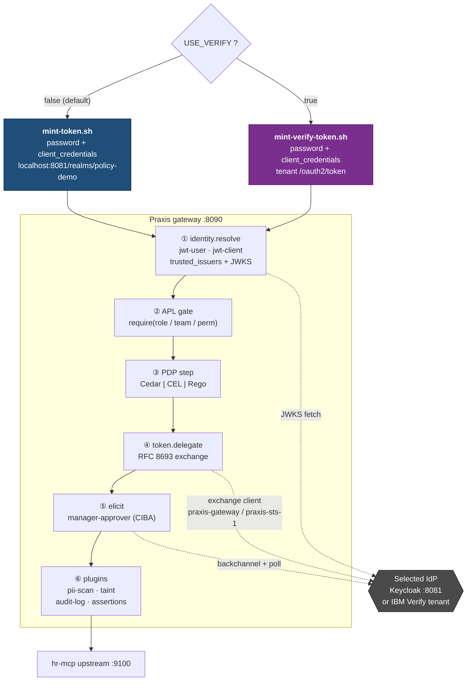
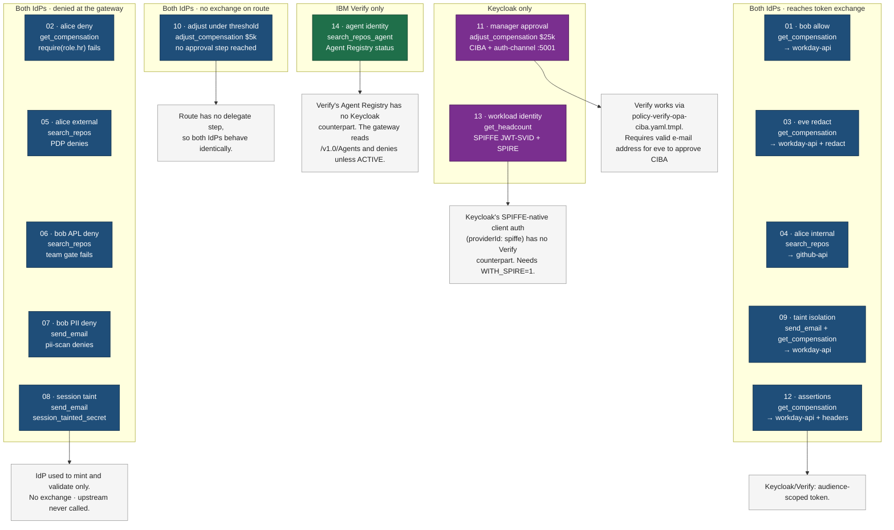

# Keycloak and IBM Verify across the scenarios

Which IdP each scenario touches, and *where* in the request path it touches it.

The IdP is one axis of the demo matrix; the PDP (Cedar / CEL / Rego) is the other.
`USE_VERIFY=true` picks the IdP the scenario scripts mint from, and
`GATEWAY_CONFIG=praxis-verify-*.yaml` picks the IdP the gateway validates and
exchanges against. Both halves must agree or every scenario fails at
`identity.resolve` with `auth.untrusted_issuer`.

## How the IdP is reached

## Per-scenario IdP reach

Every scenario mints a token from the selected IdP and has it validated at
step ① above. What differs is how much further down the chain the IdP is used —
a scenario denied at the APL gate or the PDP never reaches a token exchange.

## Verify configuration differences

- **Claim shape.** Verify emits `roles` / `teams` / `permissions` as scalars at
  N=1, so the Verify configs use `claim_mapper: ibmverify` instead of
  `standard`. Without it, `subject.roles` silently empties and every
  single-valued persona presents as a policy deny.
- **Dual-trust workaround.** The Verify configs currently trust the Keycloak
  issuer alongside Verify (commit `c596244`), because the chat agent and the
  auth-channel still mint from Keycloak on some paths. A 200 therefore does not
  prove Verify validated the token — confirm the issuer in the audit record.
- **Separate clients.** Verify refuses to let a client exchange tokens it
  issued itself (`CSIAQ5207E`), so minting uses `HR_COPILOT_CLIENT_ID` and
  exchange uses `VERIFY_GATEWAY_CLIENT_ID` — the same split as Keycloak's
  `hr-copilot` mints / `praxis-gateway` exchanges.

## Agent identity: why 13 and 14 do not port

Scenario 13 requires Keycloak SPIFFE client authentication. Scenario 14 requires
Verify Agent Registry.

| | 13 — SPIFFE workload identity | 14 — Verify agent identity |
|---|---|---|
| Credential | SPIFFE JWT-SVID, `X-Workload-Token` | OIDC JWT from `client_credentials`, `X-Agent-Token` |
| Issued because | SPIRE attested the process | the agent's OAuth client authenticated |
| IdP mechanism | Keycloak `providerId: spiffe` + `client_assertion_type: …jwt-spiffe` | Agent Registry record (`/v1.0/Agents`) linked to the client |
| Answers | "is this really the agent?" | "is this agent approved to act?" |
| Revocation | remove the registration entry; existing SVIDs live out their TTL | flip status to `SUSPENDED`; the gateway refuses within its cache TTL |
| Enforced by | Keycloak, at client authentication | **the gateway** — Verify does not gate issuance on status |
| On the other IdP | no Verify counterpart | no Keycloak counterpart |

Verify can issue tokens to suspended agents, so `run(agent-status)` reads the
registry and enforces status on the tool route. Cached status remains valid
until its TTL expires.
