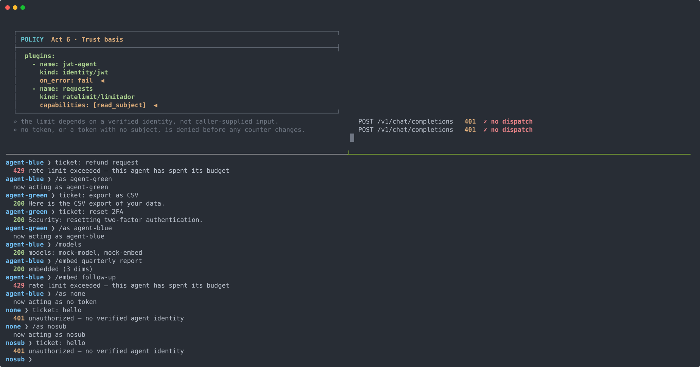

# Rate-limit an agent's requests

> **Experimental.** This blueprint uses the experimental `ratelimit/limitador`
> plugin (PPE, embedded in-memory Limitador). It is gated behind the
> `policy-experimental-ratelimit` build feature and is **not** part of a stable
> support surface. Counters are in-memory, per-instance, and per-replica: they
> reset on restart and are not shared across replicas.

**Audience.** Platform operators evaluating PPE who run AI agents against a shared
model and need to cap how often one agent calls it without starving another.

**Problem.** Agents share an expensive backend (a model, or tool endpoints). One
runaway or compromised agent can exhaust the service for everyone. A header the
agent sets is spoofable, and enforcing a cap inside the model means the call
already ran. Operators want the limit decided *in policy*, keyed to the agent's
*verified* identity, and returned as a real `429` at the gateway *before* the call
reaches the model.

**What this demonstrates.** An agent calls a shared model through the gateway. The
`ratelimit/limitador` plugin counts admitted requests in fixed windows, keyed on
the agent's resolved `subject.id` (not a header), and denies the over-budget call
with `ratelimit.exceeded` surfaced as HTTP `429`. PPE routing decides which model
routes are metered and with what allowance.

**Visible result.** `agent-blue` makes model calls under its budget (the model
serves each one), then is throttled with a plain `429` (the model never runs for
the denied call). `agent-green`, on its own budget, keeps working while `agent-blue`
is throttled, then hits its own limit. A call with no verified agent identity is
rejected outright.

## What it shows

1. **Accounting.** Each admitted `POST /v1/chat/completions` reaches the model (an
   inference is served) and advances the agent's counter by one.
2. **Admission gate.** The call that would push the counter past the limit is
   denied with `ratelimit.exceeded` surfaced as HTTP `429`, and the model serves
   nothing for it.
3. **Identity-based keying.** The counter is chosen by the verified `subject.id`.
   `agent-blue` can be throttled while `agent-green`, on its own counter, keeps
   being served.
4. **Selection.** There is no global limit, so a route with no limiter
   (`GET /v1/models`) is never throttled.
5. **Route-specific limit.** `POST /v1/embeddings` carries its own lower allowance
   and its own counter, independent of `/v1/chat/completions`.
6. **Trust basis.** Rate limiting requires a verified identity: a call with no
   `Authorization` token is rejected (`401`), and a token with no subject is denied
   with `ratelimit.no_identity` (`401`), both before any counter changes.

## Topology / What runs where

Praxis builds and runs on the **host**; the two stateless sidecars run in
**docker-compose** (each a small script on a stock `python` image, with health
checks). Ports are published to the host, so the gateway and the verification
script reach them on `localhost`.

```
  agent ──Authorization: Bearer <jwt>──▶  Praxis gateway (host :8095)
                                            │  policy filter
                                            │   • identity/jwt     → subject.id
                                            │   • ratelimit/limitador (429)
                                            ▼
                                          mock-model  (compose, :9100)
                                            serves the inference (proof of dispatch)

  jwt-issuer  (compose, static JWKS, :8888) ◀── policy filter fetches JWKS to verify tokens
```

- **Praxis gateway** — built from source (core `praxis` binary, see below),
  runs on the host on `:8095`. The `policy` filter resolves the agent's JWT
  identity, then the rate limiter admits or denies at `ratelimit.post_identity`.
- **mock-model** (`mock-model.py`, compose, `:9100`) — a deterministic stand-in
  for a shared LLM. It answers `/v1/chat/completions`, `/v1/embeddings`, and
  `/v1/models` with canned responses and records a receipt per served inference,
  so a denied call is provably never dispatched. The verification reads its
  `/__count` endpoint directly. (The recording uses this same mock model; see
  **Watch it run**.)
- **jwt-issuer** (`jwt-issuer.py`, compose, `:8888`) — serves only the public
  `jwks.json` (no live IdP, and it never exposes the private key). Agent tokens are
  minted offline from a local RSA key by `jwt/generate.sh`; the policy verifies
  them against this published JWKS.

### Trusted source of each fact

| Fact the policy depends on | Trusted source | Not trusted |
| --- | --- | --- |
| Which agent is calling (`subject.id`) | Signed JWT `sub`, verified against the issuer JWKS | any caller-supplied header |
| Which limit applies | The policy's per-route `rate_limits:` configuration | the request's own headers or body |

## Prerequisites

- `docker` (with `docker compose`), `cargo` + a Rust toolchain, `python3`,
  `openssl`, `curl`, `jq`. The sidecars run in compose; Praxis builds/runs on the
  host.
- Pinned components (see `build-praxis.sh`):
  - Praxis core **v0.8.0** (binary `praxis`; the `ratelimit/limitador` plugin
    ships in the default `policy-builtins` bundle).
  - PPE **v0.6.0** (pulled in transitively by core v0.8.0).
- No commercial IdP required; identity is a local static JWKS fixture.

> **Build note.** The rate limiter contains Limitador's panic on a bad CEL
> condition via `catch_unwind`, so it refuses to load on a `panic = "abort"`
> build. `build-praxis.sh` builds the host with `panic = "unwind"`.

## Quick start

```bash
# From this directory. First run builds the gateway from source (~5 min cold).
./run-demo.sh
```

`run-demo.sh` mints the agent tokens, starts the JWKS issuer and mock model,
builds and launches the gateway, runs the walkthrough, and exits nonzero if any
outcome is unexpected (including the over-budget denial case).

## The policy

Everything the demo enforces lives in `ratelimit-policy.yaml`, loaded by the
`policy` filter. Two plugins:

- **`identity/jwt` (`jwt-agent`)** runs at `identity.resolve`. It verifies the
  agent's RS256 token against the issuer's JWKS and maps the token's `sub` claim to
  `subject.id` via the standard claim mapper. No valid token means no resolved
  identity.
- **`ratelimit/limitador` (`requests`)** runs at `ratelimit.post_identity`, after
  identity is resolved. It keys its counter on the verified agent and nothing else:

  ```yaml
  - name: requests
    kind: ratelimit/limitador
    hooks: [ratelimit.post_identity]
    capabilities: [read_subject]          # reads only the verified subject
    config:
      namespace: chat
      bindings: { subject_id: subject.id } # explicit: no header is a key
      limits:
        - max: 3
          seconds: 60
          variables: [subject_id]          # one counter per verified agent
  ```

`capabilities: [read_subject]` and `variables: [subject_id]` are what make the
limit key on the verified agent rather than caller input: a header is never read,
so it cannot become a counter key. There are **no CEL `conditions`** anywhere;
keying is the subject binding, and which requests are limited is decided by routing
(below).

## Where limits apply (routing)

There is deliberately **no `global.rate_limits`**. A limiter is attached per
route, so a model route that lists none is simply not rate limited:

```yaml
routes:
  - http: /v1/chat/completions   # 3 requests / 60s per agent (the base limiter)
    rate_limits:
      steps: [{ name: requests }]
  - http: /v1/embeddings         # same limiter, overridden to its own counter + allowance
    rate_limits:
      steps:
        - name: requests
          config:
            namespace: embeddings
            limits: [{ max: 1, seconds: 60, variables: [subject_id] }]
  # /v1/models: absent, and no global limiter → never rate limited
```

| Route | Limiter | Per-agent allowance | Counter |
| --- | --- | --- | --- |
| `POST /v1/chat/completions` | base `requests` | 3 / 60s | `namespace: chat` |
| `POST /v1/embeddings` | override | 1 / 60s | `namespace: embeddings` (separate) |
| `GET /v1/models` | none | unlimited | — |

Authentication is global, so `/v1/models` still requires a valid agent token; it
just carries no rate limit. The `/v1/embeddings` override has its own namespace, so
its counter is independent of `/v1/chat/completions`.

## Verification

`run-demo.sh` is the repeatable check and the deterministic path: the model is
mocked (canned completions, no API key) and the "agent" is the script itself. It
builds and launches the gateway, then exercises the six beats with the
`agent-blue`, `agent-green`, and `nosub` tokens, asserting both the HTTP status at
the gateway and the model's served-inference count (via `mock-model.py`'s
`/__count`) so a denial is proven to stop dispatch, not just return a message. Any
unexpected status or count makes the script exit nonzero; this includes the
over-budget `429` and the no-identity `401`. Counters are in-memory, so each run
starts clean (the gateway is freshly launched) and completes within the 60s window.

## Watch it run

[](https://asciinema.org/a/1272880)

An optional **recording harness** drives the interactive agent through all six
beats in a three-pane terminal — a policy **spotlight** (the rule in play), the
**gateway activity** (each request admitted or denied, from the `access_log` file
sink), and the **agent REPL** (the calls). It's deterministic: the mock model
returns prepared replies, so the capture is reproducible. The committed proof of
the policy outcomes remains `run-demo.sh`.

```
┌ spotlight (policy, line highlighted) ─┬ gateway activity (200 ↗ / 429 ✗) ┐
├───────────────────────────────────────┴───────────────────────────────────┤
│ agent REPL — the six acts                                                  │
└─────────────────────────────────────────────────────────────────────────────┘
```

Prerequisites (besides those above): `tmux`, and a small Python venv for the
agent/recorder:

```bash
python3 -m venv record/.venv
record/.venv/bin/pip install -r record/requirements.txt   # httpx
record/.venv/bin/pip install asciinema                     # only to --record
```

Then, from this directory:

```bash
# Watch it live: brings the stack up, plays the acts, attaches the tmux session.
# Detach with Ctrl-b then d — the harness tears everything down on exit.
record/.venv/bin/python record/record_demo.py

# Capture it to record/demo.cast (asciinema).
record/.venv/bin/python record/record_demo.py --record

# Headless check that all three panes render (no attach) — for CI.
record/.venv/bin/python record/record_demo.py --selftest
```

To drive the agent by hand instead, `record/run-record.sh` brings the stack up and
drops you into the REPL: type a message to call the model, or `/embed <text>`,
`/models`, `/as <agent-blue|agent-green|nosub|none>`, `/quit`.

## Scope

**PPE enforces:** request admission keyed on the agent's resolved `subject.id`,
per-window fixed-count limits, and per-route placement (which model routes are
metered and with what allowance). Denied over-budget calls return a real `429`
before the model runs.

**The host / fixtures supply:** the `policy` filter invoking
`ratelimit.post_identity` after identity resolution (core v0.8.0), the static JWKS
issuer standing in for an IdP, and the mock model standing in for a real inference
service.

**Out of scope:** token-based rate limiting (`llm_tokens`) and tool-call limiting
(follow-on work); durable or shared counter storage; metering and billing. This is
an HTTP-request-count plugin only — it runs at `ratelimit.post_identity`, and a
policy that also declares a `tool:` or `llm:` route inheriting the limiter is
rejected at startup.

## Files

| File | Purpose |
| --- | --- |
| `run-demo.sh` | One-command build, launch, and verification (exits nonzero on any unexpected outcome). |
| `build-praxis.sh` | Resolves/builds the core `praxis` binary at `v0.8.0` with `panic=unwind` and the `policy-experimental-ratelimit` feature. |
| `praxis.yaml` | Gateway config: listener, `policy → router → load_balancer` chain. |
| `ratelimit-policy.yaml` | The policy document: `identity/jwt` + `ratelimit/limitador`, keying, and per-route limits. |
| `docker-compose.yml` | The two sidecars (jwt-issuer, mock model) with health checks. |
| `mock-model.py` | Deterministic mock LLM; serves the OpenAI-shaped routes and records served inferences via `/__count`. |
| `jwt-issuer.py` | Static JWKS server (serves only `jwks.json`). |
| `jwt/generate.sh` | Mints the RSA key, JWKS, and the `agent-blue` / `agent-green` / `nosub` agent tokens. |
| `record/` | Optional recording harness (three-pane tmux: policy spotlight · gateway activity · agent REPL). See **Watch it run**. |
